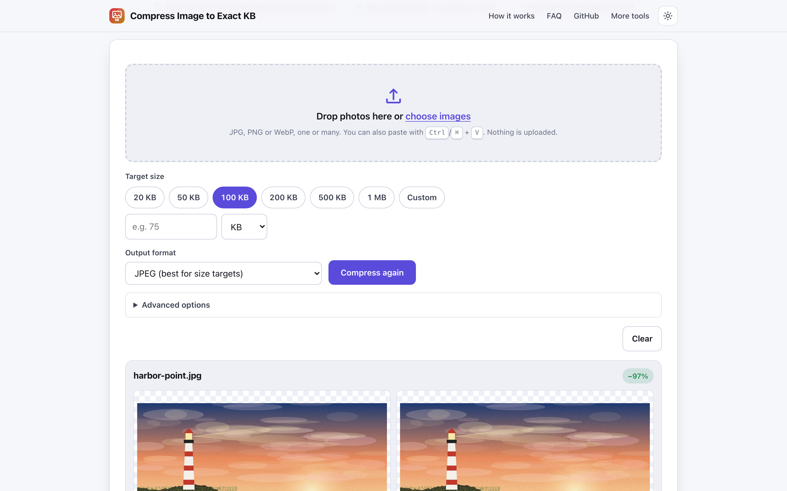
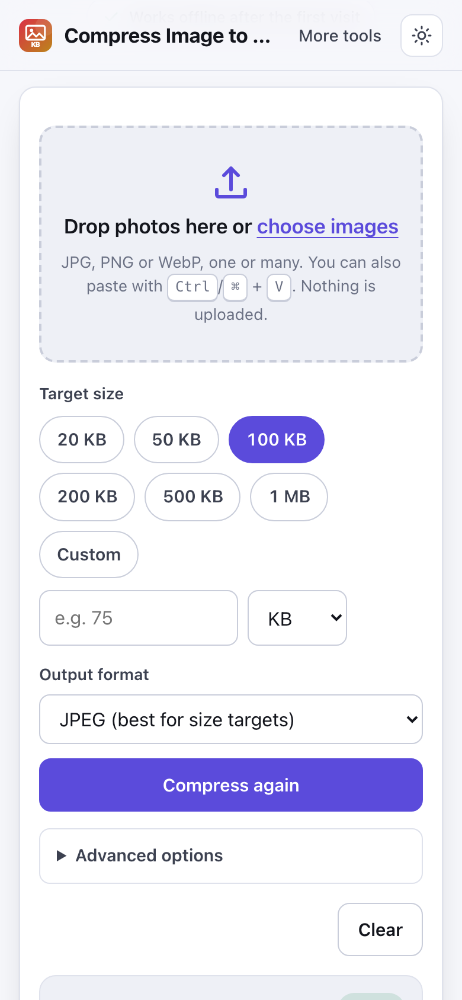

# Compress Image to Exact KB

> Shrink a photo to a target size like 50, 100 or 200 KB in your browser, with no upload.

**🌐 Use it now: [turhe123.github.io/compress-image-to-kb](https://turhe123.github.io/compress-image-to-kb/)** · free · open source · runs in your browser · works offline


## Why

Forms, job applications, exam portals and visa sites often reject photos above a fixed size, usually somewhere between 20 and 500 KB. Compress Image to Exact KB is a free, open-source alternative to tools like iLoveIMG Compress Image and ReduceImages, which upload photos to their servers, show ads, and apply daily limits and sign-up prompts for batches, and which offer no exact target size. Here your files never leave the device, there is no account, no ads and no limits, it works offline, and it can be installed as an app. You choose a size, and the tool finds the best quality that fits.

## Screenshots

<p align="center"></p>

<p align="center"><em>Compress Image to Exact KB in the browser, light theme</em></p>

<p align="center"></p>

<p align="center"><em>Compress Image to Exact KB on a phone</em></p>

## Features

- Pick a target size from the chips (20, 50, 100, 200, 500 KB, 1 MB) or type a custom value in KB or MB.
- Automatic size search: a binary search on quality finds the highest quality that fits under the target. If quality alone cannot get there (below 40%), the image is scaled down in small steps, never narrower than your minimum width.
- To be safe with portals, 1 KB is treated as 1,000 bytes, so results pass whether a site counts 1,000 or 1,024 bytes per KB.
- Batch mode: add many files at once, with a per-file Download button and a sequential Download all button (no zip).
- Before and after previews on every card, with original size, new size, percent saved, final quality and final dimensions.
- If the target cannot be reached at the minimum width, the card says so and offers the smallest result achieved. If the original is already under the target, it is offered unchanged instead of being inflated.
- Advanced options: minimum width, optional maximum width and height, and a background colour for transparent areas when the output is JPEG.
- Metadata is always removed: re-encoding on a canvas drops EXIF data, including GPS location and camera details. Photo rotation is applied first, so pictures stay upright.
- Add files by dropping, by choosing them with the keyboard-accessible drop zone (Enter or Space), or by pasting from the clipboard with Ctrl/⌘ + V.
- A "Try a sample photo" link generates a fictional lighthouse picture on the device.
- Clear error messages for unsupported files, empty (0 byte) files, HEIC photos and images that fail to decode.
- Heavy work runs in a Web Worker when OffscreenCanvas is available, with a main-thread fallback otherwise.
- Light and dark themes, a layout that works down to 390 px wide, and an installable PWA.
- Downloads are named like `passport-100kb.jpg`; non-ASCII file names are preserved.

**Formats and limits**

- Input: JPG, PNG, WebP, GIF, BMP and AVIF (as far as your browser can decode them). HEIC/HEIF is not supported; export it as JPEG first. Animated GIF and WebP keep only the first frame, with a notice.
- Output: JPEG (default, best for size targets), WebP, or keep the original type. PNG input is flattened onto the chosen background colour when converted to JPEG.
- Very large images are downscaled to at most 16 megapixels before the first encode, and the card tells you.
- The smallest custom target is 1 KB. Very small targets on large images force heavy downscaling; the card shows the final dimensions.

## How to use

1. Drop photos on the box, choose them, or paste one with Ctrl/⌘ + V. (Or try the sample photo.)
2. Pick a target size, or enter a custom one, and optionally change the output format or advanced options.
3. Press Compress (or just add files; they are compressed straight away). To try another size, change the target and press Compress again.
4. Check the before and after preview and the stats, then download each file, or use Download all for a batch.

## Privacy

- Nothing is uploaded. Files are read and processed on your device and are never sent to a server.
- No cookies.
- Page views are counted anonymously with [GoatCounter](https://www.goatcounter.com/), which is cookieless and open source.
- The page works offline: after your first visit a service worker caches it.

## Run it locally

```sh
git clone https://github.com/turhe123/compress-image-to-kb
cd compress-image-to-kb
python3 -m http.server 4173
```

Then open http://127.0.0.1:4173/ in your browser. There is no build step.

## Tests

```sh
npm i -D @playwright/test && npx playwright install chromium
npx playwright test
```

## Third-party code

None: browser APIs only.

## Built with AI

Compress Image to Exact KB was written by [Claude Code](https://claude.com/claude-code) inside an automated pipeline, from a plain-English spec. No code or assets from any commercial product were used; it is a clean-room implementation of a feature set, not a copy.

What that means in practice:

- The full source is in this repo under the MIT license. Read it before you trust it with your files.
- Everything runs in your browser. It makes no network requests except an anonymous, cookieless page-view count (GoatCounter); your files never leave the device.
- The page is tested headless in Chromium (Playwright) before every release, but it has had less human review than hand-written software. Bug reports and pull requests are welcome.

## Support ❤️

If this saved you time or a paid subscription, you can say thanks on Ko-fi: https://ko-fi.com/leodavidai

## More free web tools

Find more free, private, in-browser tools at https://turhe123.github.io/web-tools/.

## License

MIT © Or Davidai Bachar
